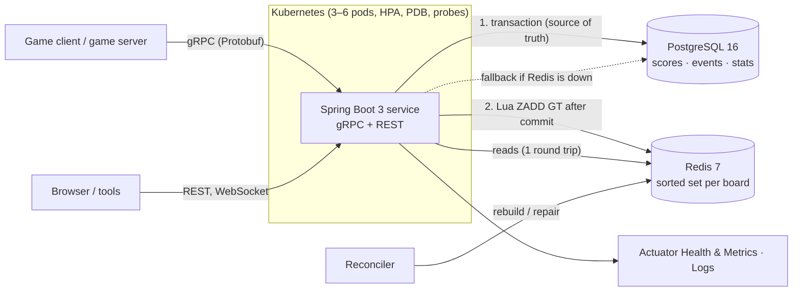

# Game Leaderboard Service

A gameplay-services-style backend that captures player stats and powers real-time global, friends, and seasonal leaderboards built with **Spring Boot 3**, **gRPC**, **PostgreSQL**, and **Redis**.

[](https://github.com/Anshhhhh-chand/LeadershipServ/actions/workflows/ci.yml)
-91%25-brightgreen)


---

## Features

- **Global, seasonal, weekly and daily boards:** Weekly and daily boards reset on schedule (UTC, ISO weeks), and past periods stay viewable.
- **Player rankings & percentiles:** Your rank, percentile, and the players just above and below you.
- **Friends leaderboard:** You vs. your friends, ranked among yourselves.
- **Stats and achievements:** Matches, wins, win rate, best score, match history, and achievements that unlock once.
- **Live updates:** A gRPC server stream and a WebSocket push top 10 updates as they happen.
- **Reliable writes & cache consistency:** Retries cannot double-count (idempotency keys), races cannot lose an update (optimistic locking), and reads survive cache outages (PostgreSQL source of truth fallback).

---

## Architecture Overview



- **Write path:**
  1. Idempotency check.
  2. Single PostgreSQL transaction: score event, version-checked score update (`@Version`), stats upsert, achievements.
  3. **After commit**, atomic Lua call executes `ZADD GT` in Redis and returns new rank.
- **Read path:**
  - One Lua call against the Redis sorted set returns the page, names, and ranks without touching PostgreSQL.

---

## Quickstart

```bash
make up && make seed && open http://localhost:8080/demo
make demo-bot            # in another terminal: watch the board move
```

Requires Docker. `make seed` loads 3 games, 8 leaderboards, 100k players and 500k score events in about a minute.
- Demo Page: http://localhost:8080/demo
- Swagger UI: http://localhost:8080/swagger-ui.html
- Actuator Health: http://localhost:8080/actuator/health
- Actuator Metrics: http://localhost:8080/actuator/metrics

`make help` lists all available development targets.

---

## API Examples

### gRPC (Primary API)

Protobuf contract defined in [`leaderboard.proto`](src/main/proto/leaderboard/v1/leaderboard.proto). Reflection is enabled:

```console
# Top N Query
$ grpcurl -plaintext -d '{"leaderboard":{"game_id":"fc-mobile","leaderboard_id":"season-1-high-score"},"n":3}' \
    localhost:9090 leaderboard.v1.LeaderboardService/GetTopN
{
  "entries": [
    { "rank": "1", "player_id": "5a127460-8815-44f8-9abf-33d4eb0e149c", "display_name": "NeonPhantom158", "score": "64443" },
    { "rank": "2", "player_id": "b55b1d26-7d90-4aca-8700-af60497abb01", "display_name": "NeonBlaze569", "score": "56898" },
    { "rank": "3", "player_id": "bad3c25c-e272-42cb-ad5b-5864f44d52cb", "display_name": "TurboPanda7972", "score": "51425" }
  ],
  "total_players": "100000",
  "as_of": "2026-10-14T09:22:07.477982Z"
}

# Submit Score
$ grpcurl -plaintext -d '{"leaderboard":{"game_id":"fc-mobile","leaderboard_id":"season-1-high-score"},
    "player_id":"aa3aef52-a354-4707-96b7-260b66b2a3c0","score":70000,"idempotency_key":"match-7f3c","win":true}' \
    localhost:9090 leaderboard.v1.LeaderboardService/SubmitScore
{ "improved": true, "best_score": "70000", "rank": "1", "previous_rank": "49996" }

# Player Rank with Neighbors
$ grpcurl -plaintext -d '{"leaderboard":{"game_id":"fc-mobile","leaderboard_id":"season-1-high-score"},
    "player_id":"aa3aef52-a354-4707-96b7-260b66b2a3c0","around":1}' \
    localhost:9090 leaderboard.v1.LeaderboardService/GetPlayerRank
```

### REST API

```bash
# Top 10
curl "localhost:8080/api/v1/games/fc-mobile/leaderboards/season-1-high-score/top?n=10"

# Player rank around me
curl "localhost:8080/api/v1/games/fc-mobile/leaderboards/season-1-high-score/players/{playerId}/rank?around=2"

# Player stats
curl "localhost:8080/api/v1/games/fc-mobile/players/{playerId}/stats"

# Submit score
curl -X POST localhost:8080/api/v1/games/fc-mobile/leaderboards/season-1-high-score/scores \
  -H 'Content-Type: application/json' -d '{"playerId":"...","score":4200,"idempotencyKey":"match-123","win":true}'
```

RPCs: `SubmitScore`, `BatchSubmitScores`, `GetTopN`, `GetPlayerRank`, `GetFriendsLeaderboard`, `StreamTopN` (server streaming), `GetPlayerStats`, `GetScoreHistory` (paginated).

---

## Design Decisions

| Decision | Rationale |
|---|---|
| **Redis sorted sets, not `ORDER BY`** | Top N and "my rank" in O(log N), no database query on the hot read path. |
| **PostgreSQL first, Redis after commit** | The source of truth wins; Redis can only lag, never lie. |
| **`ZADD GT` in Lua** | Idempotent, atomic and order-independent cache updates; rank returned in 1 round trip. |
| **Optimistic locking (`@Version`) + retry** | Conflicts are rare under standard conditions; avoid pessimistic locks on hot rows. |
| **Idempotency keys** | Client retries must never double-count matches or wins. |
| **Rebuild lock, circuit breaker, reconciler** | No cache stampede; reads survive Redis outages; background reconciliation repairs drift. |
| **gRPC first, thin REST** | Typed Protobuf contract, HTTP/2 multiplexing, streaming; REST for browser clients. |
| **Period keys (`2026-W42`)** | Resets without data deletion; old periods stay queryable. |
| **Competition ranking (1, 2, 2, 4)** | Fair tie handling, identical in Redis and the SQL fallback. |

---

## Testing

Run unit tests and integration tests against real PostgreSQL 16 and Redis 7 via Testcontainers:

```bash
make test  # Unit tests
make it    # Integration tests (requires Docker)
```

Highlights:
- **`ConcurrentSubmitIT`:** 2,500 simultaneous submissions, 0 lost writes, lock retries verified.
- **`IdempotencyIT`:** Sequential and concurrent duplicate submissions counted exactly once.
- **`RedisLossRecoveryIT`:** Cache wipe recovery rebuilding identical top 100 from PostgreSQL.
- **`RedisDownFallbackIT`:** Verifies circuit breaker fallback to SQL queries when Redis container is down.
- **`ApiEvolutionIT`:** Verifies backwards compatibility against frozen proto definitions.

---

## Observability

Lightweight local observability with Spring Boot Actuator, Micrometer core, and structured JSON logging:
- **Health:** http://localhost:8080/actuator/health
- **Metrics:** http://localhost:8080/actuator/metrics (e.g. `leaderboard.query`, `leaderboard.optimistic.lock.retries`, `leaderboard.redis.fallback`, `leaderboard.drift.fixed`, `leaderboard.players`)
- **Logs:** Structured Logback logs with JSON format support.

---

## Kubernetes Deployment

Deploy to a local kind cluster:

```bash
make kind-up deploy seed-k8s rollout-demo
```

Features included:
- 3 replicas with `maxUnavailable: 0` for zero-downtime rolling updates.
- Startup, readiness, and liveness probes.
- Graceful gRPC shutdown (HTTP/2 GOAWAY).
- Horizontal Pod Autoscaler (HPA 3–6 pods), PodDisruptionBudget (PDB), and PostgreSQL StatefulSet.

---

## License

[MIT](LICENSE)
